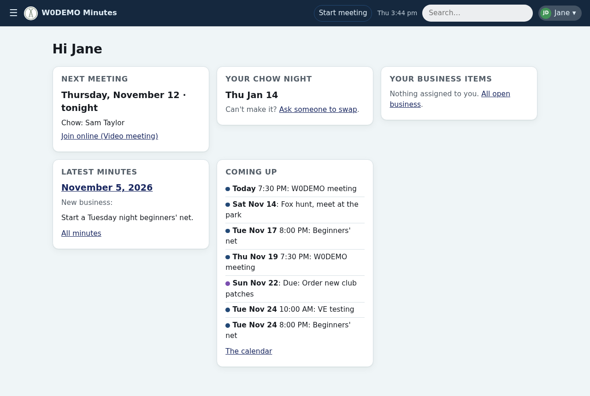
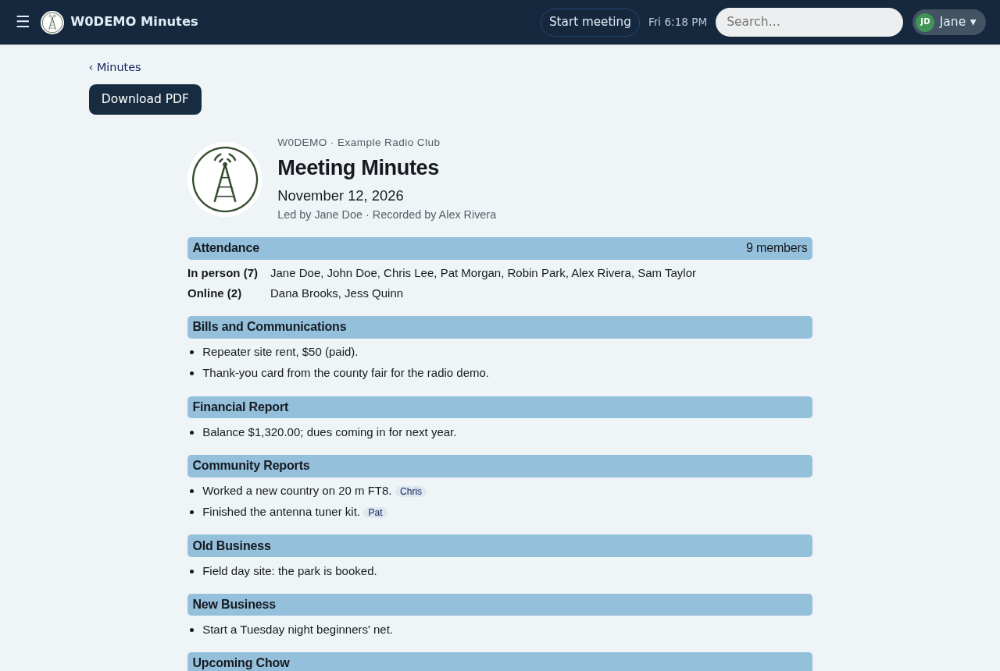
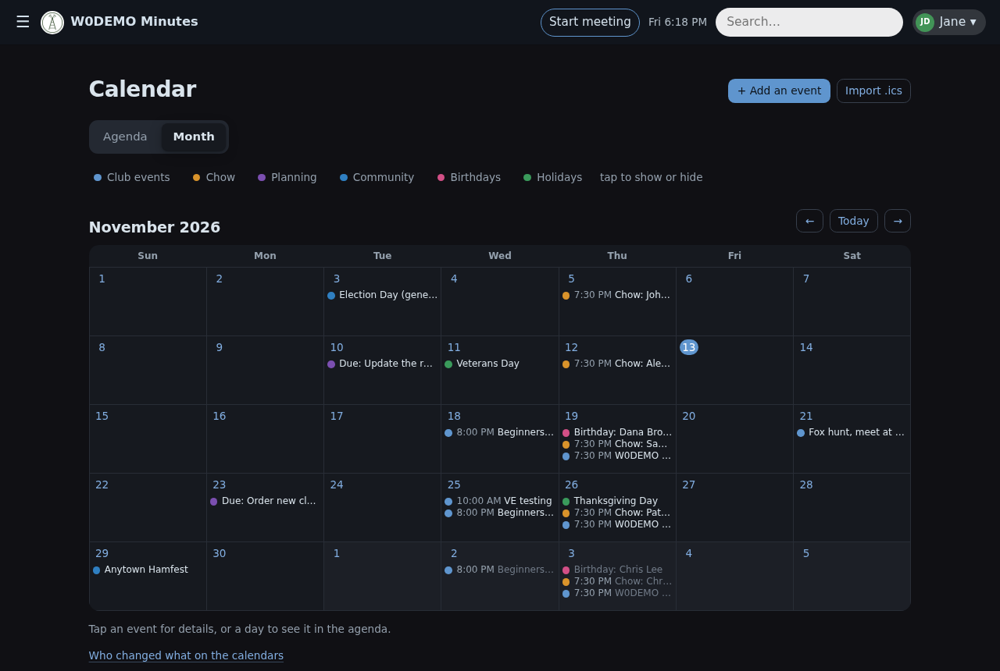
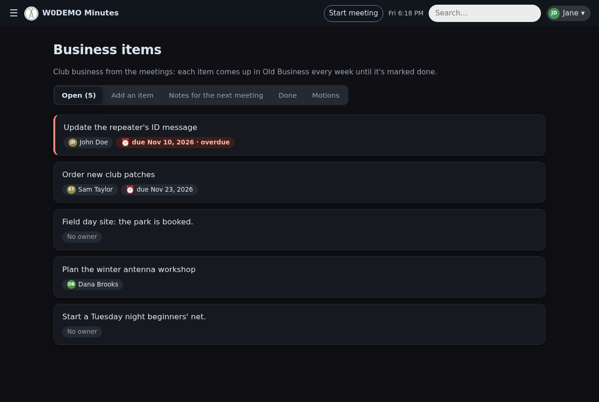
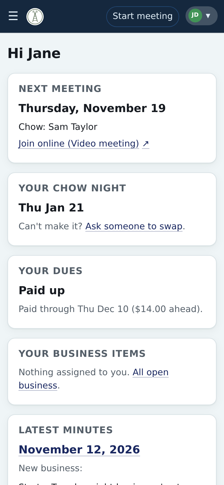
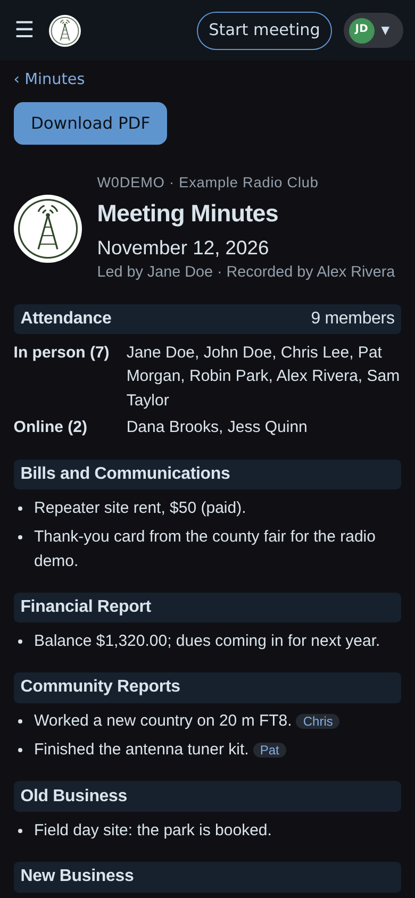

# Club Minutes

A web app for running an amateur radio club's meetings and records. Whoever takes the minutes does it live on meeting night while members follow along, then publishes and emails them with one button. Around the minutes it keeps attendance, Old and New Business from week to week, the club's calendars, the roster, an optional chow rotation and the treasurer's books. Members sign in with a passkey or an emailed link and see what's next for them on Home. It runs on one small Linux server with no database server and no cloud account: the data is plain files the club owns, backed up encrypted. Each club sets its own name, logo, colours, meeting night and agenda in the app.

| Home | The minutes | Calendar (dark mode) |
|---|---|---|
|  |  |  |

| Business items (dark mode) | On a phone | On a phone, dark mode |
|---|---|---|
|  |  |  |

The screenshots are of a made-up club (`demo/`); `uv run python demo/screenshots.py` takes them again.

## What it does
Every change is listed in [CHANGELOG.md](CHANGELOG.md).
- **Archive:** each meeting is a Markdown file at `data/meetings/YYYY-MM-DD/minutes.md`, next to the original PDF. An optional importer converts a club's old minutes (PDFs, and `*CORRECTED*.txt`) with a plain parser, no AI; it was written for one club's layout, so another club's old minutes may need its patterns adjusted (`importer.py`); imported meetings are marked "imported, unreviewed".
- **Home:** what's next for you: the next meeting, your chow night and swap requests, your business items, the latest minutes and upcoming events.
- **Minutes:** the archive (`/minutes`) in the modernized layout with PDF download (View original instead for imported minutes), one search box for the minutes (full text), members, guests, business items, chow nights and calendar events, per-member history, attendance stats with a chart, and guest tracking.
- **Leader console:** take the minutes live on meeting night while members follow along, then submit to publish and email them.
- **Members:** sign-in with passkeys or an emailed link, the roster, member profiles, and admin mode (with a Security page: sign-ins, devices, failed attempts and bans).
- **Business items:** Old and New Business tracked from week to week, with owners, due dates and reminders. Motions keep their mover, seconder and result (Business → Motions).
- **Calendar:** the club's calendars kept by the app, with a place and an online meeting link per event, .ics import and subscriptions ([officers guide](docs/officers.md)).
- **Chow schedule** (optional module): the rotation, swaps, reminders before your night, and who provided, missed or covered each night.
- **Treasurer:** who owes what (dues, fees, missed chow, certificates), payments and expenses, regular bills and bills read at meetings, and funds a committee keeps; each member sees their own figures on Home.
- **Site** (admins): the club's name, callsign, logo and colours, the meeting night and its place and online link, the agenda's sections, optional features, holidays by country or state, bylaws references and date formats, all in the app.
- **Email preferences:** each member turns each kind of email on or off, including a meeting-day email (the time, your chow, your business items, the calendar until the next meeting and last meeting's minutes). Every optional email ends with a link to change it. The daily `reminders` timer (8 am) sends business and chow reminders and the meeting-day email.

## Install
On a Debian server or container (tested on Debian 13), as root:
```sh
curl -fsSL https://raw.githubusercontent.com/KO4CGQ/minutes/main/deploy/setup.sh | bash
cp /opt/club-minutes/club.example.yaml /etc/club-minutes/club.yaml   # then fill it in and: systemctl restart club-minutes
club-minutes first-member N0CALL --first Jane --last Doe --email jane@example.org --class General   # prints your sign-in link
```
The [server admin guide](docs/server-admin.md#getting-started-a-new-club) walks through it: the HTTPS address, email, admin mode and backups.

## Guides
- [Members guide](docs/members.md): signing in, Home, your profile and emails, chow swaps, business, the calendar, your dues.
- [Officers guide](docs/officers.md): the roster and profiles, calendars, the chow schedule, the Treasurer.
- [Server admin guide](docs/server-admin.md) (a new club starts at Getting started): deploy, config, sign-in and email, admin mode, backups, hardening.
- [Developer guide](docs/developers.md): running it locally, previews, releases, security checks.
- [Security](SECURITY.md): reporting a vulnerability privately, and what's checked on every change.

## License
Copyright © 2026 James Flattery, KO4CGQ.

This program is free software: you can redistribute it and/or modify it under the terms of the GNU Affero General Public License as published by the Free Software Foundation, either version 3 of the License, or (at your option) any later version. See [LICENSE](LICENSE).

If you run a modified version for others over a network, you must offer them its source code (AGPL section 13). The About page's source link does this for the club's copy.
