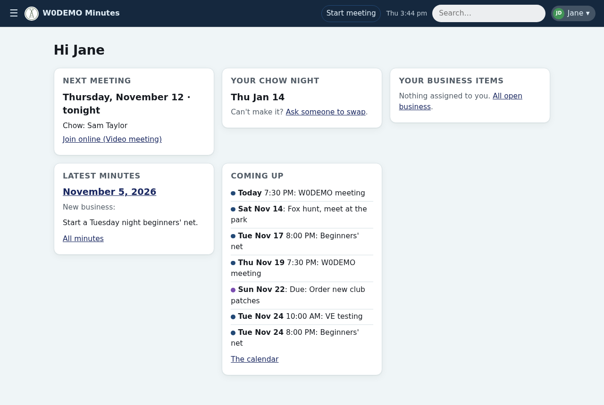
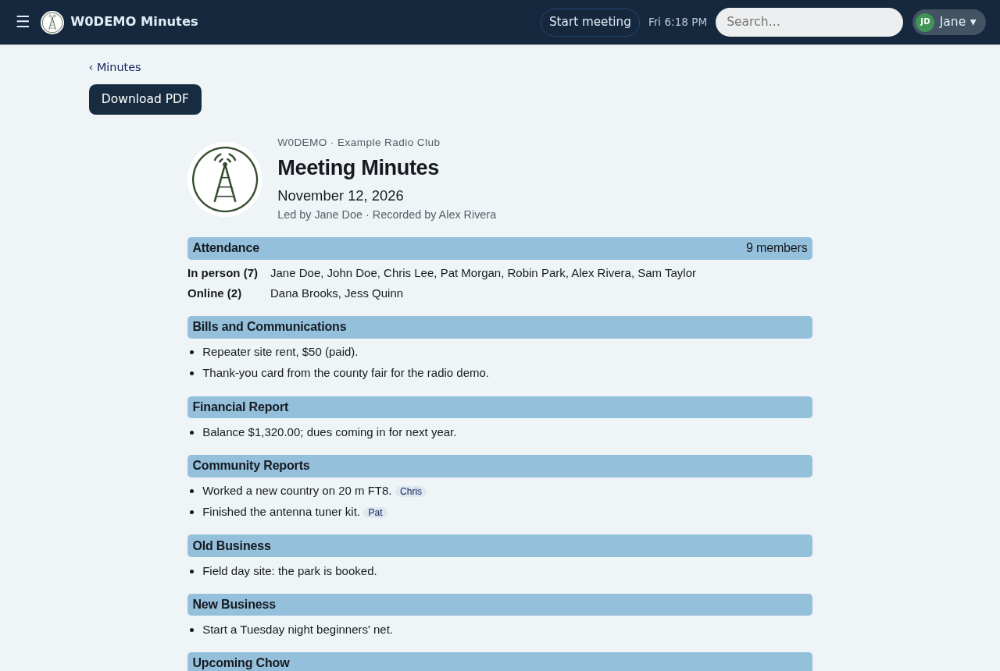
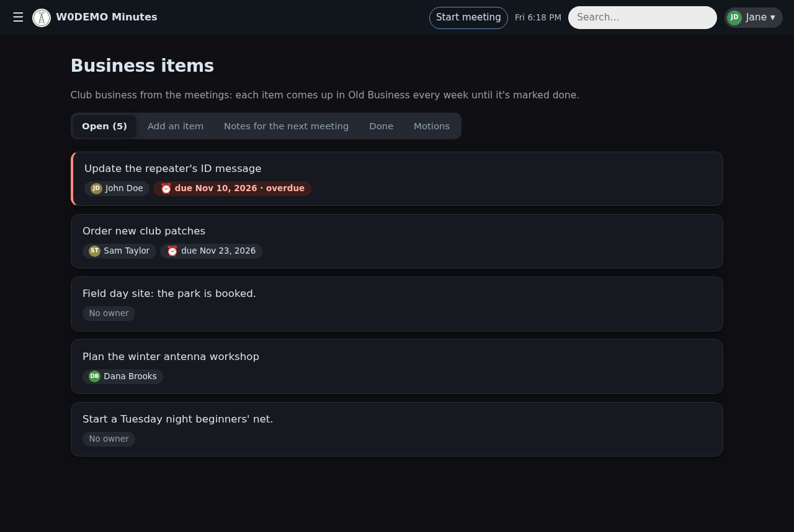
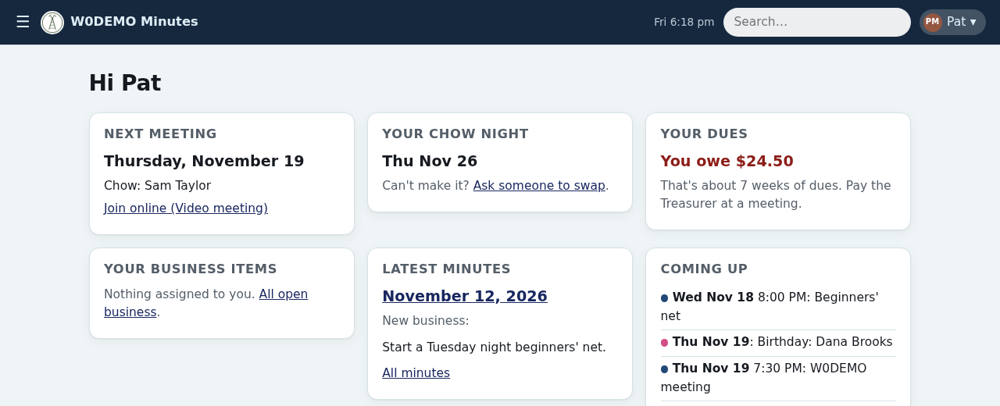
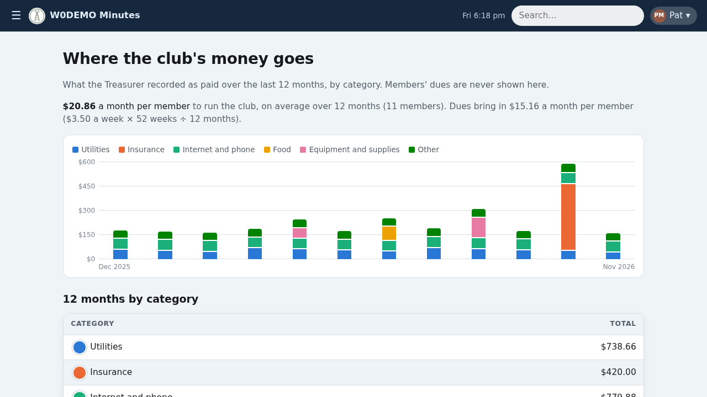

# Members guide

For every member: what the app does for you, and where to find it. It's in the app too: **Help**, in the menu under your name.

## 🔑 Signing in
Sign in with a passkey (your phone or computer's fingerprint, face or PIN), or ask for a one-time link by email to the address the club has for you. After an emailed link, the app offers to add a passkey on your device (or add one any time under Profile → Sign-in & passkeys), so next time is one tap.

> [!TIP]
> Stuck signing in? Ask an admin.

🔐 **A password manager makes this easier.** It can keep your passkey for this app and offer it on every phone and computer where you use it, so signing in is one tap wherever you are. It does the same for the rest of your online life: it keeps your other sites' passkeys too, and for sites that still use passwords it creates a different strong one for each, remembers it and fills it in. You remember just one.

New to these? The EFF explains [what a passkey is](https://www.eff.org/deeplinks/2023/10/what-passkey) (from 2023: since then, passkeys sync across Apple, Google and Windows devices through most password managers, and can be moved from one password manager to another) and [how to choose a password manager](https://ssd.eff.org/module/choosing-the-password-manager-that-s-right-for-you), from the ones built into your phone or browser to apps like Bitwarden or 1Password.

## 🏠 Home
What's next for you: the next meeting (and, on meeting night, a link to follow the minutes live), your chow night and any swap requests to answer, your business items, your dues, the latest minutes and the next two weeks of the calendar.

## 👤 Your profile, emails and settings
Your name menu → **Your profile**:

- 📇 **Contact details and birthday:** change your email, phone, address and birthday (a month alone is fine). Officers always see them; other members see only what you tick to share. A shared birthday, and each year you've been a member, gets a mention at the meeting that week.
- ✉️ **Email:** turn each kind of email on or off: the minutes (with the PDF or as a link), the meeting-day reminder, reminders for business you're looking after, the chow list (with the PDF or as a link) and roster updates.
- ⚙️ **Settings:** how the app shows things to you, like the first day of the week.

## 📝 Minutes and search
**Minutes** lists every meeting, newest first, with a PDF of each. The search box finds minutes, members, guests, business items, chow nights, calendar events and these guides. A name also finds its common nicknames (Richard, Rich, Rick and Dick find each other, member or not), and a member's name its other spellings from the roster; a typo is caught when nothing else is found.

## 🍲 Chow
**Chow** shows the schedule and your nights. Can't make yours? Ask another member to swap; they approve or decline from their Home page. Not bringing chow and not arranging a swap can cost a fee, if the club sets one.

## 📌 Business
**Business** lists the club's open items; tap one to see its comments and history. Anyone can comment; if an item is yours, update it or mark it done. Can't make a meeting, or have news? Leave a note (Business → Notes for the next meeting) and the leader reads it out.

## 📅 Calendar
**Calendar** shows the club's events, chow nights, shared birthdays and holidays. "Subscribe in your calendar app" gives you a private link for your phone, Apple Calendar, Outlook or Google. An event held online too (like the weekly meeting) has a **Join online** button with its meeting link, and the link is in your calendar app as well.

> [!TIP]
> Keep your subscription link to yourself: anyone with it can see the club's calendar. Lost track of who has it? **Make a new link**, and the old one stops working.

## 💵 Your dues
The app's money pages (your dues here, and Spending below) start when the Treasurer turns on **tracking**: one switch for both. With it on, the Treasurer records in the app the dues members pay and the bills the club pays, and the app works out the rest. Until then there's no dues card on Home and no Spending page. The Treasurer may check the figures with the officers first, before members see anything.

Once tracking is on, Home shows what you owe (or that you're paid up, and through which date) and, if your club has a certificate each member buys once (some clubs call it a bond), whether you still need to buy it. 🔒 Only you and the officers see your figures. Pay the Treasurer at a meeting.

> [!NOTE]
> **An example:** with dues of $3.50 a meeting night, someone who's paid for all but the last 7 meeting nights sees **You owe $24.50**, "about 7 weeks of dues". Paid ahead? Home says which date you're paid through instead.

## 📊 Where the club's money goes
With tracking on (the same switch as your dues, above), **Spending** in the menu shows what the club paid over the last 12 months, by category (utilities, insurance, internet, food, equipment) and by month. Nobody's dues are shown there. It also shows what running the club costs per member each month, next to what dues bring in.

