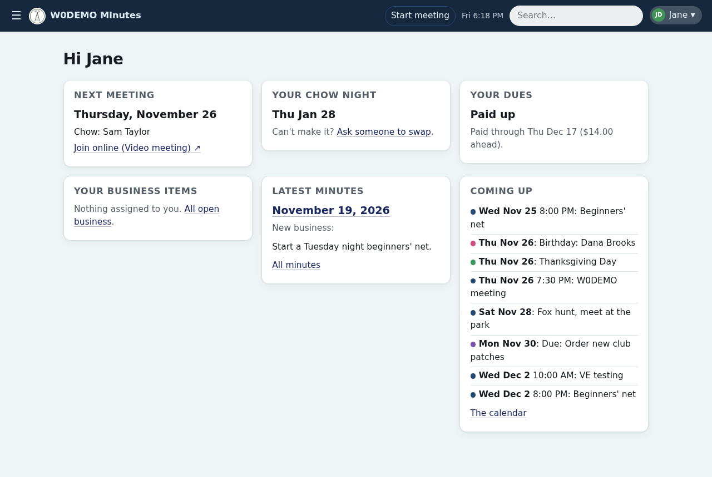
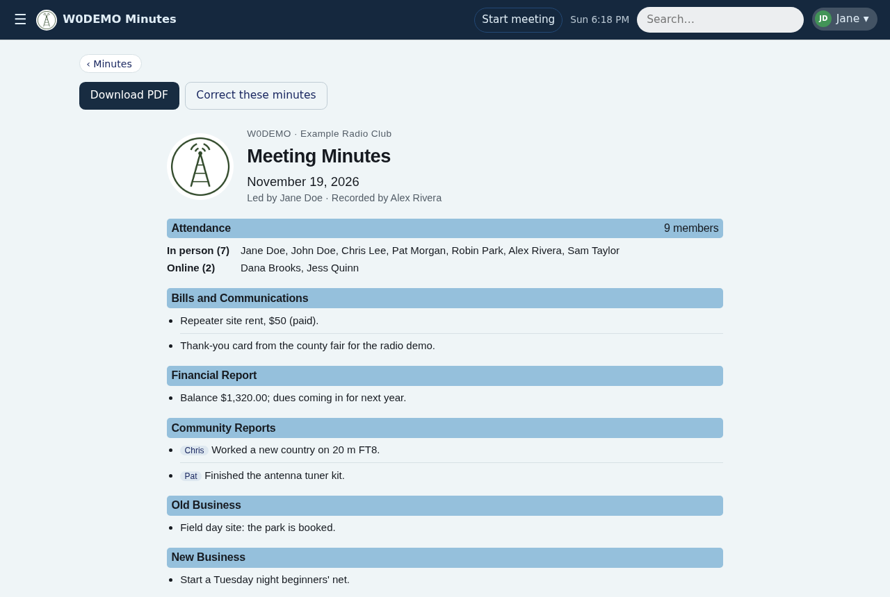
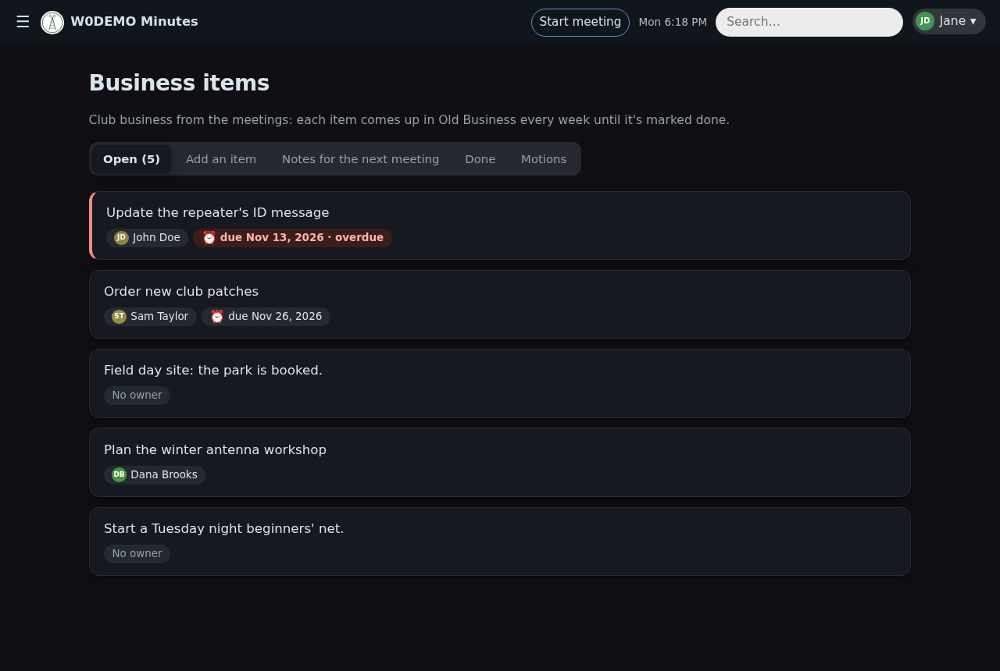
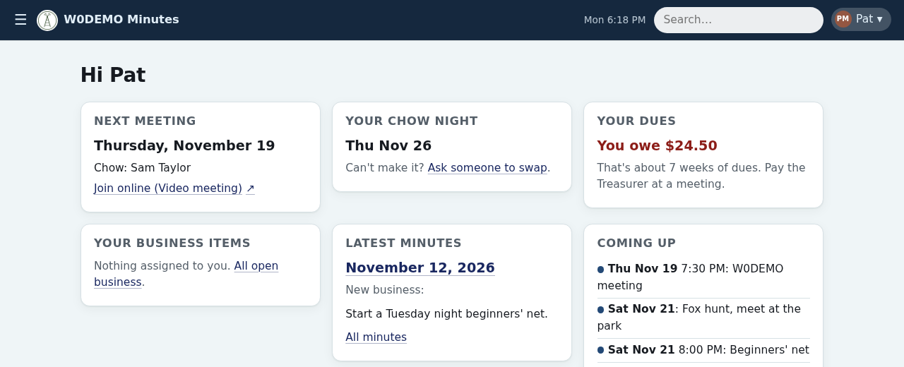
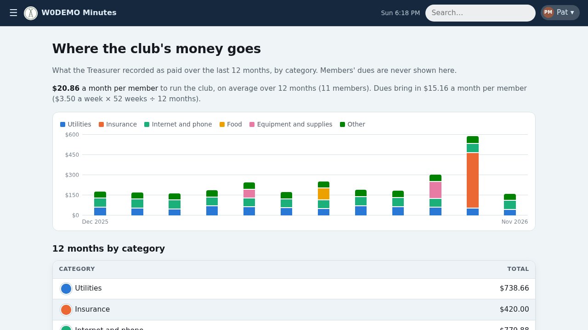

# Members guide

For every member: what the app does for you, and where to find it. It's in the app too: **Help**, in the menu under your name.

## 🔑 Signing in
Sign in with a passkey (your phone or computer's fingerprint, face or PIN), or ask for a one-time link by email to the address the club has for you. After an emailed link, the app offers to add a passkey on your device, unless you already have one there (or add one any time under Profile → Sign-in & passkeys), so next time is one tap. Sign-in links are limited to a few an hour (a passkey always works); on a browser you've signed in with before, a stranger asking for links in your name can't use them up.

> [!TIP]
> Stuck signing in? Ask an admin.

🔐 **A password manager makes this easier.** It can keep your passkey for this app and offer it on every phone and computer where you use it, so signing in is one tap wherever you are. It does the same for the rest of your online life: it keeps your other sites' passkeys too, and for sites that still use passwords it creates a different strong one for each, remembers it and fills it in. You remember just one.

New to these? The EFF explains [what a passkey is](https://www.eff.org/deeplinks/2023/10/what-passkey) (from 2023: since then, passkeys sync across Apple, Google and Windows devices through most password managers, and can be moved from one password manager to another) and [how to choose a password manager](https://ssd.eff.org/module/choosing-the-password-manager-that-s-right-for-you), from the ones built into your phone or browser to apps like Bitwarden or 1Password.

## 🏠 Home
What's next for you: the next meeting (and, on meeting night, a link to follow the minutes live), your chow night and any swap requests to answer, your business items, your dues, the latest minutes and the next two weeks of the calendar.



## 👤 Your profile, emails and settings
Your name menu → **Your profile**:

- 📇 **Contact details and birthday:** change your email (a link goes to the new address; it changes once you open it, and you're signed out everywhere, so sign in again), phone, address and birthday (a month alone is fine). Officers always see them; other members see only what you tick to share. A shared birthday, and each year you've been a member, gets a mention at the meeting that week.
- ✉️ **Email:** turn each kind of email on or off: the minutes (with the PDF or as a link), the meeting-day reminder, reminders for business you're looking after, the chow list (with the PDF or as a link) and roster updates.
- ⚙️ **Settings:** how the app shows things to you, like the first day of the week, and whether the menu shows **Support Club Minutes** (the Ko-fi link at its foot; hide it if you already give toward the app).

## 📝 Minutes and search
**Minutes** lists every meeting, newest first, with a PDF of each. The search box finds minutes, members, guests, business items, chow nights, calendar events and these guides. A name also finds its common nicknames (Richard, Rich, Rick and Dick find each other, member or not), and a member's name its other spellings from the roster; a typo is caught when nothing else is found.

Minutes list anyone who has applied for membership and not yet been voted on, with the member who sponsors them (name only, nothing from their application), and the vote's result with its counts, never who voted how.

Published minutes don't change when the club's settings or roster change (members' names, the agenda, the club's name and links, date formats): they stay as they were the night they were made. Minutes can be corrected after the meeting, and a correction makes a new version. A corrected meeting's footer says which version it is, who corrected it, when and why, with a link to the version before; you get an email listing what changed, the same way you get the minutes. Imported minutes (from before the app) say whether someone has reviewed them.

**Names:** the app shows members by a short name: the first name alone ("Jill"), or, when another member has the same first name, with as much of the last name as tells them apart ("Jill S", or "Jill Do" and "Jill Du" when both start with D). Only current members count for this, so a member who left doesn't change anyone's name; a former member's own name gets the letters it needs, so their old reports still point to them. A club can show full names everywhere instead (an admin's choice, on Admin → Site → Club).



## 🍲 Chow
**Chow** shows the schedule and your nights, 16 to a page. Can't make yours? Ask another member to swap; they approve or decline from their Home page. Not bringing chow and not arranging a swap can cost a fee, if the club sets one.

## 📌 Business
**Business** lists the club's open items; tap one to see its comments and history. Anyone can comment (the meeting's leader may pick a comment to go in the minutes, which every member gets); if an item is yours, update it or mark it done. An item, a comment or a note takes up to 5,000 characters; the count is under the box. Add up to four pictures to an item of yours, or to a comment (the **Picture** button above the box): a quote, a photo of the tower. Tap a picture to see it full size. Can't make a meeting, or have news? Leave a note (Business → Notes for the next meeting), with pictures if you like, and the leader reads it out; it goes in the minutes with its pictures.



## 🎥 Video meeting
If the club has video meetings (its own Jitsi Meet server and the video meetings plugin), **Video meeting** in the menu lists the club's rooms you can join. Each has a **Join** button that opens the meeting in a new tab, already signed in as you: no other password. Joining sends the video server your name and callsign.

- **Who hosts:** the members whose roles allow it (officers and meeting leaders, usually).
- **Rooms for certain members** (the board, say): the page says who. Other members wait in the lobby until a host lets them in, or don't see the room at all.
- **Guests:** send them a room's address, shown on its card (the club calendar links to it too). Anyone not signed in can sign in there or join as a guest; guests wait in the lobby until a host lets them in, even if they come before anyone else. Some rooms are for members only.
- **What guests may do:** each room says. If they must ask to unmute, turn their camera on or share their screen, a host allows it in the meeting as usual.

If the club allows it, you can open **a room of your own**: give it a name on the Video meeting page, share its address, and you host it until a day passes with no one joining it here. Its card stays on the Video meeting page for you until then. A calendar event can link to one of the club's rooms.

## 📅 Calendar
**Calendar** shows the club's events, chow nights, shared birthdays and holidays; a meeting that's called off shows as "No meeting" with the reason, and a rescheduled one on its new date (you're emailed either way). "Subscribe in your calendar app" gives you a private link for your phone, Apple Calendar, Outlook or Google. An event held online too (like the weekly meeting) has a **Join online** button with its meeting link, and the link is in your calendar app as well.

> [!TIP]
> Keep your subscription link to yourself: anyone with it can see the club's calendar. Lost track of who has it? **Make a new link**, and the old one stops working.

## 💵 Your dues
The app's money pages (your dues here, and Spending below) start when the Treasurer turns on **tracking**: one switch for both. With it on, the Treasurer records in the app the dues members pay and the bills the club pays, and the app works out the rest. Until then there's no dues card on Home and no Spending page. The Treasurer may check the figures with the officers first, before members see anything.

Once tracking is on, Home shows what you owe (or that you're paid up, and through which date) and, if your club has a certificate each member buys once (some clubs call it a bond), whether you still need to buy it. 🔒 Only you and the officers see your figures. Pay the Treasurer at a meeting.

> [!NOTE]
> **An example:** with dues of $3.50 a week, someone who's paid for all but the last 7 meeting nights sees **You owe $24.50**, "about 7 weeks of dues" (months or years, if the club's dues are monthly or yearly; under half a period reads "less than a week's dues"). Paid ahead? Home says which date you're paid through instead.



## 📊 Where the club's money goes
With tracking on (the same switch as your dues, above), **Spending** in the menu shows what the club paid over the last 12 months, by category (utilities, insurance, internet, food, equipment) and by month. Nobody's dues are shown there. It also shows what running the club costs per member each month, next to what dues bring in (weekly or yearly dues converted to a month).



## 🔒 What's kept, and who sees it
- **Your details:** officers and admins see your email, phone, address and birthday (a club can let other roles see them too); other members see only what you tick under **Share with all members** on your profile. Replies to the minutes email go to whoever took them and whoever led the meeting, and replies to a correction's email to whoever made it, each only if they share their email.
- **Corrected minutes:** earlier versions are kept, and members can open them from the minutes page. A correction that removes private details (a health matter, a phone number) keeps the earlier versions (and an imported meeting's original PDF) for those who can correct minutes only. Members are usually emailed what changed. Lines taken out are never quoted; a reworded line's old words are, unless **This removes private details** is ticked.
- **Formatting:** above a report, business item or comment box (and every item box in the leader console), the toolbar's buttons make text **bold** or *italic*, start a bulleted or numbered list (Enter starts the next item; Enter on an empty one ends the list), quote some lines, or the lines you selected (an email you drafted, say; Enter continues the quote, Enter on an empty quote line ends it), mark `code` (on an empty line, or over several lines, a code block, shown exactly as typed), put in a link (a small form: the web address, `example.org` is enough; words to show, if you want any; and a QR code, if you want one; with the cursor on a link, the form opens with it to change), add pictures, and the eye (Preview) shows the text as it will appear (pictures aside); it turns into a pencil, Back to editing, which returns to the box with its text (you can also type the marks: `**bold**`, `*italic*`, `- item`, `> quote`, `` `code` `` and ```` ``` ```` on the lines before and after a block). Web addresses always show in full, so a printed copy keeps them: a link with words, `[the form](https://example.org/form)`, shows as "the form (https://example.org/form)". A link with a QR code (typed: `[QR]` after it) gets its code after the text, on screen and in the minutes PDF, so someone reading it on paper can scan it. Each code is numbered, as its link is in the text, with the link's words or address under it. Type `@` and the start of a name to mention an Active member: pick from the list (arrow keys and Enter, or a tap) and their name shows as a pill linking to their page (it is only a link: nobody is notified). Anything typed that looks like HTML shows as plain text.
- **Pictures:** pictures on reports, business items and comments are for members only, never public. They're shrunk and saved anew, without the hidden details a phone adds (such as where it was taken). An officer can remove one.
- **Video meetings:** joining sends your name and callsign to the club's video server.
- **Admin recovery:** if the officers ever have to recover admin access, every member is emailed at each step.
- **Sign-ins and email:** the app keeps sign-in records (internet address and browser) for 90 days, plus your latest sign-in, and a log of the emails it sends for 90 days. Admins can see both. Your browser also keeps a "known browser" cookie (`club_minutes_known`, 400 days): it lets you get sign-in links by email on a browser you've signed in with, without the hourly limit that applies to strangers. It never signs anyone in, and **Sign out everywhere** makes it stop counting.
- **If you're made Inactive (or a Silent Key):** your email choices, settings, passkeys and sign-in records are deleted the next night (failed sign-in attempts, which are only a time and an address, age out after 90 days like everyone's), and your address leaves the Email log. Ninety days after that, your email, phone, address, birthday, photo and calendar feed link are deleted from the roster too (made Active again before then, they stay); your name, callsign and years of membership are kept. (If there's nothing of yours to delete, no countdown starts.) Backups made earlier still hold them until they age out. Made Active again, you sign in with an emailed link and add a passkey again. Minutes already published keep your name where they recorded it (attendance, reports, motions).
