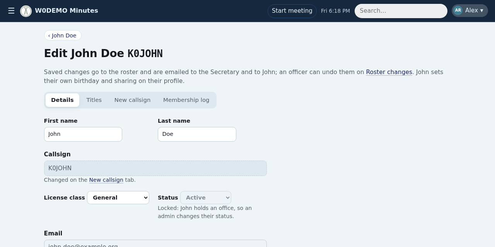
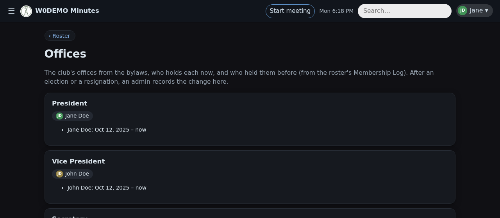
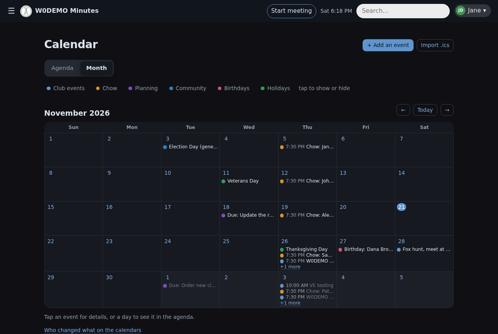
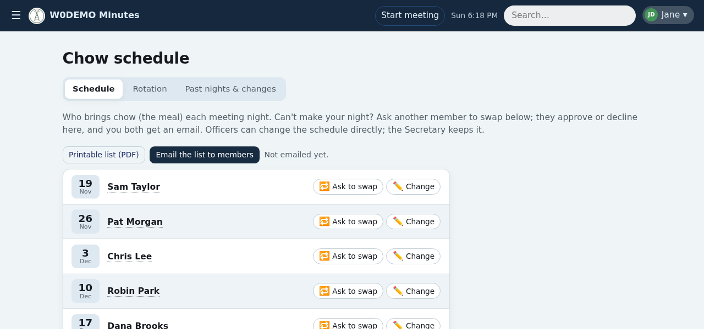
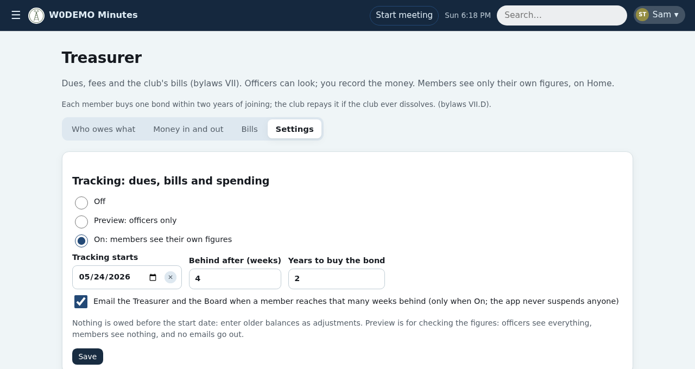
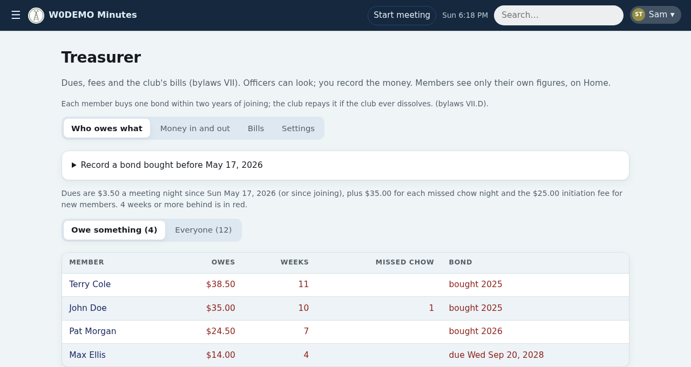
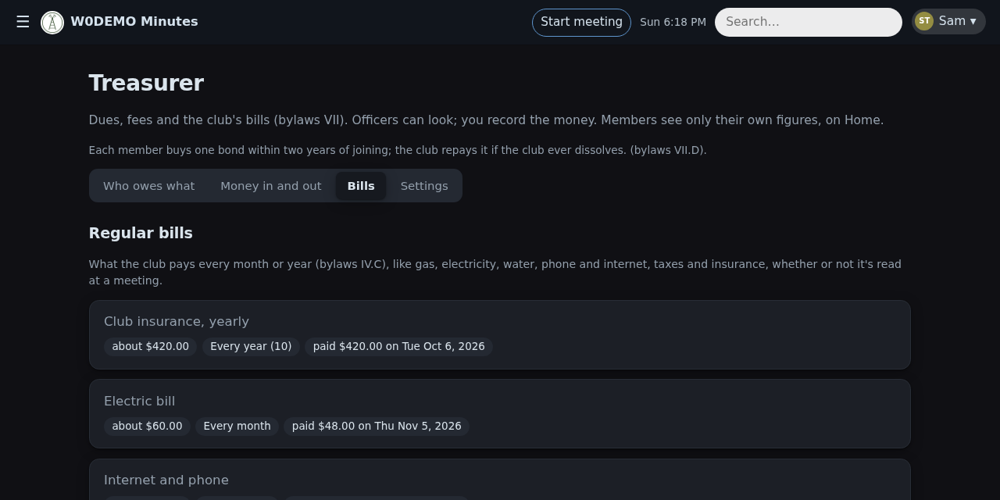
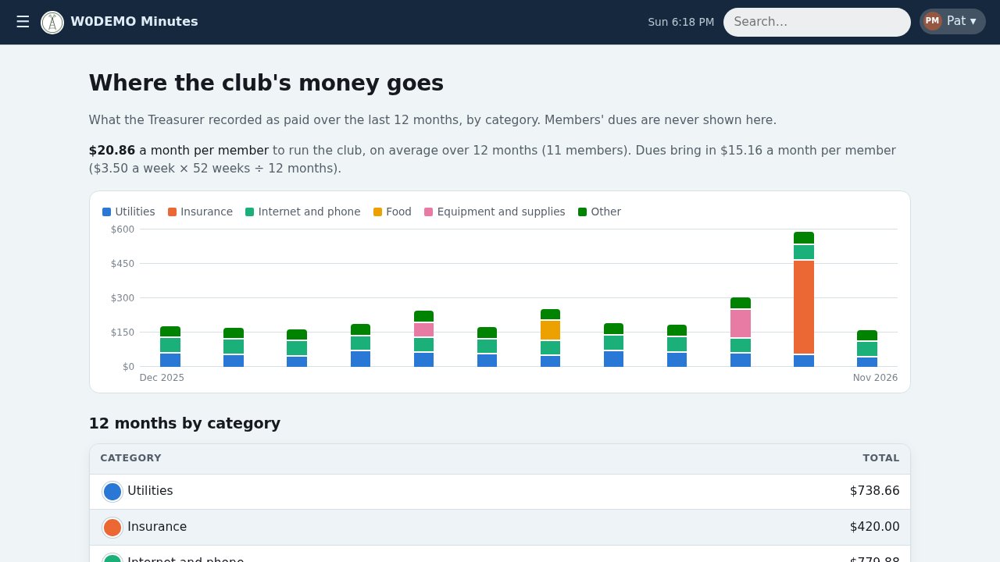

# Officers guide

For officers, meeting leaders, minutes editors, roster keepers, calendar editors and the Treasurer: running the club from the app. What every member sees is in the [members guide](members.md).

## 🔑 Who can do what
What a member may do comes from their **roles**. A role is given by the offices a member holds (the whole office title: "Assistant Treasurer" isn't the Treasurer's office, and a title that isn't an office gives no role) and by members picked by hand. Admins set what each role allows, which offices give it and who is picked, and add the club's own roles, on **Admin → Site → Roles**. A member's roles show on their page. As each role ships:

- 🏛️ **Officers** (holders of an officer's office) see every member's contact details and Roster changes, and can undo profile changes; they moderate (any business item, motions, comments, pictures, the calendar change log), lead meetings and edit the calendar too.
- ✏️ **Minutes editors** (holders of any office) correct minutes already in the archive. A meeting's own leader and recorder may always correct its minutes.
- 🎙️ **Meeting leaders** (picked on Site → Roles) run the meeting console and edit the minutes and the calendar.
- 📅 **Calendar editors** (picked on Site → Roles, say the net manager) edit the calendar.
- 📋 **Roster keepers** (holders of the offices that add members: the Secretary and Treasurer, unless the club picks others) edit the roster.
- 📨 **The Secretary** gets the roster emails (new members, roster changes, the chow list).
- 💰 **The Treasurer** records money, and sees the Treasurer pages.

> [!TIP]
> Admins can do all of the above while admin mode is on.

## 👥 The roster
**Roster** in the menu. Members keep their own email, phone, address, birthday and sharing choices up to date on their profile.

- **Officers see everything**; other members see only what each member chose to share.
- **Every profile change** is emailed to the Secretary and listed under **Roster → Recent changes**, where any officer can undo it.
- **Editing a member** (roster keepers): **Edit roster details** on their page, in four tabs, each saved on its own. **Details:** name, license class (amateur radio clubs), status, contact details and other spellings of their name. **Titles:** their offices (shown; they change on the Offices page, which keeps their history) and other titles (ticked from those the club uses, or added). Roles aren't set here: they follow the offices, or an admin gives them on Site → Roles. **New callsign** and **Membership log** (joined, left, suspended…). Not their birthday or sharing choices: those are theirs.
- **Another member's email or status** are permissions of their own (Roster keeper has both, as it ships). A member's email, status and callsign are changed by an admin in admin mode, not a roster keeper, when the member holds an office, is an admin, or can do something the roster keeper can't; their phone, address, titles and other spellings stay everyday roster edits. A new email waits for its owner: a link goes to the new address and the old one is told at once; the change happens when the link is opened, and signs the member out everywhere.
- **Callsigns are optional.** In an amateur radio club (Admin → Site → Club), a member's callsign and license class may be left blank when adding them; they're shown by name, and the **New callsign** tab adds one later. A club that isn't an amateur radio club doesn't see callsigns or license classes anywhere, and the **New callsign** tab is gone.
- **A new callsign** (vanity call or upgrade): **New callsign** on the same page. The app records the new call and the date on the Membership log and keeps the old call as one of their other spellings. Nothing else moves, and old links and sign-ins keep working. Their page address now uses the new call.
- **Birthdays and anniversaries** a member shares show at the meeting's Attendance step.
- **Recover admin access** (a link at the foot of the Offices page, `/recover`): for when the club can't reach its admins, or one is working against it. An officer names a member to become admin (any active member; they accept it themselves) and, if needed, admins to suspend, with the board's motion if there was one. A majority of the officers (at least 2) approve, each confirming it's them with a passkey or emailed link; once the member has accepted, it completes after 7 days. If an admin objects, it needs two-thirds of the officers and 14 days: an objection can delay it, not stop it. Every member is emailed at each step. The officer who started it can call it off, or a majority of the officers by each asking; and if it isn't approved and accepted within 30 days, it ends by itself. A suspended admin's rights stop counting (club.yaml's too) until another admin lifts it on Admin → Security → Admins. It can't protect against someone with the server itself.
- **Offices** (Roster → Offices): who holds each office now and who held it before. An admin changes a holder in one step; the app updates both members' titles, logs it and emails the officers. **Add a past term** adds history only.

## 📅 Calendars
**Calendar** in the menu. The app keeps three calendars: **Club events** (meetings, nets, VE testing, fox hunts), **Planning** (officers' dates, like the annual meeting) and **Community** (what's on nearby). It adds chow nights, shared birthdays (never private ones), business items' due dates (on Planning), and holidays and election days if an admin turned them on.

**Adding and changing events** (leaders and calendar editors):

- Start, optional end, where, notes, an **Online link** (shown as a **Join online** button), and a time zone if it isn't the club's (Field Day in UTC, say).
- **Repeats**: daily, weekly, every 2 weeks, monthly (2nd Tuesday, last Tuesday, 1st and 3rd Tuesday, or a date), yearly.
- Change or delete a repeating event for **this date only**, **this and following dates**, or **every date**.
- Look-alike events on the same day are marked **possible duplicate**; delete one if they're the same.
- **Leave out of the leader console's Upcoming Events**: tick it for things not worth reading out (the weekly meeting is ticked already).
- **Who changed what** (officers) lists every change.

> [!TIP]
> To cancel a meeting night, do either: delete that one date of the weekly meeting, or add a Club events entry on that date whose title starts with **No meeting** (for example "No meeting (Thanksgiving)"), which also tells members why; the weekly meeting then doesn't show that night. Either way the night is off Home's next meeting, the business notes' meeting list and the chow schedule's new nights. Nights already in the chow schedule stay as they are.

**The weekly meeting** is on Club events. To change its day, time, place or online link, an admin uses **Admin → Site → Club** and picks the date it starts; earlier meetings stay as they were.

📥 **Import .ics** (Calendar → Import .ics): events from Google Calendar, Outlook or Apple. In Google Calendar: Settings → Import & export → Export. Importing the same file again updates rather than doubles. Anything it can't bring in is listed, to add by hand.

📲 **Subscribing:** every member gets a private link under **Subscribe in your calendar app**, for their phone or calendar app. **Make a new link** if it's been shared by mistake. An admin can also make some calendars public (Admin → Site → Features); chow, birthdays and due dates are never public.

## 🎙️ At the meeting
Whoever starts the meeting in the console is marked present: in person when they're on the meeting place's network, online otherwise. Tap their name in Attendance to change it.

If the club has a quorum rule (an admin sets it on Site → Agenda), the console's Attendance step shows whether there is a quorum as you mark people present. Only Active members count, never guests. Without a quorum, the step where you add a motion warns you not to bring motions up yet; once enough members are present, it shows how many votes a motion needs to pass (a majority of the members present). The minutes and their PDF record the result under Attendance; minutes from before the rule, or from a club without one, show nothing. A correction to the attendance updates that line to match.

Each step of the leader console has a box ready to type in. **New Business** has two cards, **Items** and **Motions** (tap a card's title to fold it away): a motion records who moved it, what, who seconded it and the result, with pictures if wanted (the Picture button above "moved to"). A business item's formatting and pictures go in the minutes with it.

Under each business item, the console shows the comments members wrote since the last meeting: **Add to the minutes** puts one in tonight's minutes, under the item (tap again to take it out); nothing goes in unless you pick it. **Record what's said** adds what someone says about the item at the meeting: pick who said it (a member, or type a guest's name) and type it. It becomes their comment on the item, marked as said at the meeting and recorded by you, and goes in the minutes under the item. ✖ deletes one recorded by mistake.

The leader console's **Upcoming Events** step lists what's on until the next meeting, to read out. A repeating event (a weekly net) shows once, at its next date; untick **Show a repeating event once (its next date)** to see them all. **+ Add** puts one in the minutes. **Use the calendar's** swaps a typed entry for the calendar's own, so it shows once. Events you add in the minutes go on the calendar you pick beside them (Club events unless you change it). A report's box has a toolbar when you type in it: bold, italic, lists, a link (with words and a QR code if you like: printed with a numbered code in the PDF, so a paper copy still works) and pictures (up to four; they go in the minutes and their PDF).

✏️ **Correct these minutes**, on a meeting's page, fixes minutes already in the archive (the console only works on a meeting in progress). The meeting's leader and recorder can, and so can any board member and an admin in admin mode. Open a part (attendance, guests, any section) to change it; **+ Add** adds a guest or an item left out, **Remove** takes one out (click again to keep it; a row you just added goes at once). Say why in a line ("Corrected a misspelled name"), then **Preview the changes**: the version now and the new one side by side, removed lines in red, added ones in green, and in a changed line the words that changed. Saving makes a new version: the old one stays readable, linked from the footer, which shows who corrected it and why. **Send the corrected minutes to members** (ticked) emails them what changed: a changed line's new text and the few words it replaced, and only how many lines were removed, never their words. Untick it for something no one needs telling about, and the footer says "no notice sent". **This removes private details**: tick it when taking out something that shouldn't have been recorded (a health matter, a phone number); the email then shows no old words at all, and every earlier version (an imported meeting's original PDF too) is visible only to those who can correct minutes. A report's pictures can be removed here (tick **Remove picture**), not added. Old Business and Upcoming Chow are the text read that night: correcting them doesn't change the business items or the chow schedule.

Imported minutes (from before the app) say "not yet reviewed" until someone reads them against the original: **Mark as reviewed** if nothing needs fixing, or correct them, which reviews them too.

## 🍲 Chow
Only if the club has the chow module (an admin turns it on under Admin → Site → Features). **Chow** in the menu.

- Members ask each other to swap; leaders change the list directly.
- On meeting night the console records who provided, missed or was covered.
- **The printable list** (PDF): officers email it to members from the Chow page, which shows whether it has changed since it was last sent.

## 💰 Treasurer
**Treasurer** in the menu: officers see it; the Treasurer (and admins in admin mode) record money and change settings.

⚙️ **Getting started (Settings tab):**

- **Tracking:** Off, **Preview** (officers see everything, members nothing, no emails: for checking the figures first) or **On** (members see their own figures on Home).
- **Start date:** nothing is owed before it. Older balances go in as adjustments on that date.
- **Amounts:** dues, initiation fee, the bond, a missed chow night. Each change has a date it takes effect, so earlier charges keep the old amount. Dues come **a week, a month or a year** at a time: pick the period with the amount and its date (for a year, also the month and day it falls due, e.g. July 1; not February 29). The period fields are for dues only and ignored for the other amounts. A club that changes from weekly to yearly dues on a date is charged weekly before it and yearly after.
- **Arrears:** how many periods behind counts (4 by default; weeks, months or years, whichever the dues are now), and whether the Treasurer and Board get an email when someone gets there.
- **Accounts, funds** and **spending categories** (up to 8, each keeps its chart colour).

🧾 **Who owes what** is worked out, never typed: dues for each due date (weekly dues fall due on every meeting night, holidays too: 52 × $3.50 is $182 a year; monthly dues on the 1st of each month; yearly dues on the day you picked), counted from the first due date on or after tracking started or the member joined (someone who joins mid-month starts with the next 1st), initiation, missed chow nights and adjustments, less payments. Members may pay weekly, monthly or yearly; paying ahead shows as "paid through" the day before the first due date the payment doesn't cover. Members in arrears show in red.

> [!NOTE]
> **An example:** dues are $3.50 a meeting night and tracking started 26 weeks ago, so a long-time member owes $91.00 so far. Pat has paid $66.50: Pat owes **$24.50**, about 7 weeks, in red (4 weeks or more). Max joined 8 weeks ago: the $25.00 initiation fee plus 8 nights ($28.00), less what he's paid.

**The bond** (only if the club has one): who still owes it and by when. A bond bought before the app: **Record a bond bought before…** at the top of Who owes what. It's kept on file, not counted as money now.

> [!IMPORTANT]
> **Arrears and suspension:** the app never suspends anyone. When the club does, a roster keeper sets the member's status to **Suspended** and adds a Membership Log row. Dues keep counting.

**Recording money:** each expense gets a category guessed from its words ("pizza" → Food), which you can change. Payments, other income (drink sales, donations), adjustments (a charge, or a negative one as a credit) and expenses, each with a date and an account. **Delete** fixes a mistake; the log keeps it.

📄 **Bills:**

- **Regular bills** (Bills tab): what the club pays every month or year. The tab shows which haven't been paid yet.
- **Bills read at meetings:** each amount under Bills and Communications in the minutes gets its own card ("Gas Bill $81"). Mark each **Paid** (an expense), **Not a bill**, or match it to a regular bill so it isn't counted twice. Nothing counts until it's marked. **Look in older minutes** finds bills from before the start date.
- At the meeting, the console's Bills step lists what was paid since the last one; **Add to tonight's bills** puts it in the minutes.

🥤 **Funds** run by a committee (the drinks fund, say): their keepers see only their fund's account and record its money.

📊 **Spending** (in the menu): the last 12 months by category, and the cost per member each month next to what dues bring in. Every member sees it once tracking is On. It never shows anyone's dues.

> [!NOTE]
> Not a bookkeeping system: no account balances or transfers yet.

## 🛡️ Choosing an admin
Admins can see and change everything in the app while admin mode is on: every member's contact details, the roles,
the backups, the updates and the Security page. A **server admin** also signs in to the server itself, so can read
every file there. Choose them the way the club would choose who holds its bank card.

**How many.** At least two, so the club isn't locked out if one is unavailable (the Admin page warns while there's
only one). They needn't be officers. If the club ever can't reach its admins, the officers can make a new one:
**Recover admin access** (above, under The roster).

**Who.** A member the club trusts with every member's personal details, who will be around for a while, and who is:

- **Careful with accounts:** a password manager, a different password for everything, a passkey or two-step sign-in on
  their own email (their email is a way into admin mode), a screen lock on their phone, and never sharing a sign-in.
- **Security-minded:** suspicious of unexpected links and requests (an "officer" emailing to ask for someone's
  details, say), and quick to tell the club when something looks wrong.
- **Comfortable with the app** (an app admin), or **also with a command line** (a server admin): signing in to the
  server over SSH, pasting the commands the [server admin guide](server-admin.md) gives, and reading a log. Updates and
  backups run from the Admin page, so day to day a server admin rarely needs the command line; it's for when
  something goes wrong.

**Before they start** (a checklist for the officers and the new admin):

1. They read the [server admin guide](server-admin.md) (a server admin) or its Admin mode and Security parts (an app admin).
2. On a test copy, if the club has one (a staging server): turn on admin mode, change a role and put it back, view
   the app as a member, and (a server admin) restore a backup into an empty folder and run an update.
3. They know the club's rules for its IT: who else holds each password (two people for each), where the backup
   passphrase is kept, and who they answer to.
4. They sign the club's admin agreement (below), kept with the club's records.
5. An existing admin adds them on Admin → Security → Admins; they confirm they can turn on admin mode.

**When an admin steps down:** add the successor first (the last active admin can't be removed), hand over or
change the passwords they held, and remove them on Admin → Security → Admins.

### An admin agreement (a template)
Adapt it to the club's bylaws and records; it isn't legal advice.

> **[Club name] — Club Minutes administrator agreement**
>
> I, **[name, callsign]**, agree to serve as an administrator of the club's Club Minutes app
> (☐ app admin ☐ server admin) from **[date]**, and that:
>
> 1. I'll use admin access only for club business, and only what the job needs.
> 2. Members' personal details (contact details, birthdays, dues, attendance) are confidential: I won't copy, share or
>    keep them outside the app, except the club's own backups.
> 3. I'll keep my accounts secure: a unique password in a password manager, a passkey or two-step sign-in on the email
>    I use for the club, and I won't share my sign-in.
> 4. I'll tell **[the President / the Board]** within **[24 hours]** of anything that may have exposed club data or
>    my access (a lost phone, a suspicious sign-in, a mistake).
> 5. When I step down, or if the Board asks, I'll hand over what I hold (passwords, keys, the backup passphrase) and
>    help add a successor. I understand the officers can recover admin access without me if they need to.
>
> Signed: ____________________ Date: __________
>
> For the club (President): ____________________ Date: __________
>
> Witness (Secretary): ____________________ Date: __________
