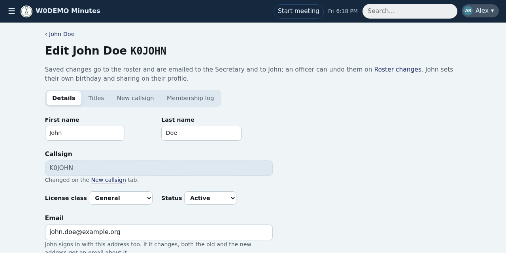
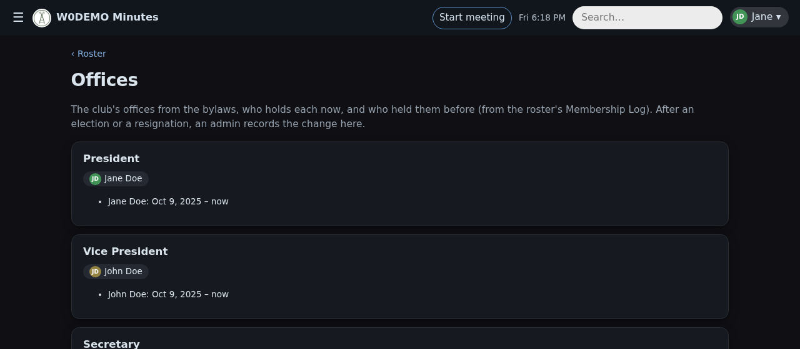
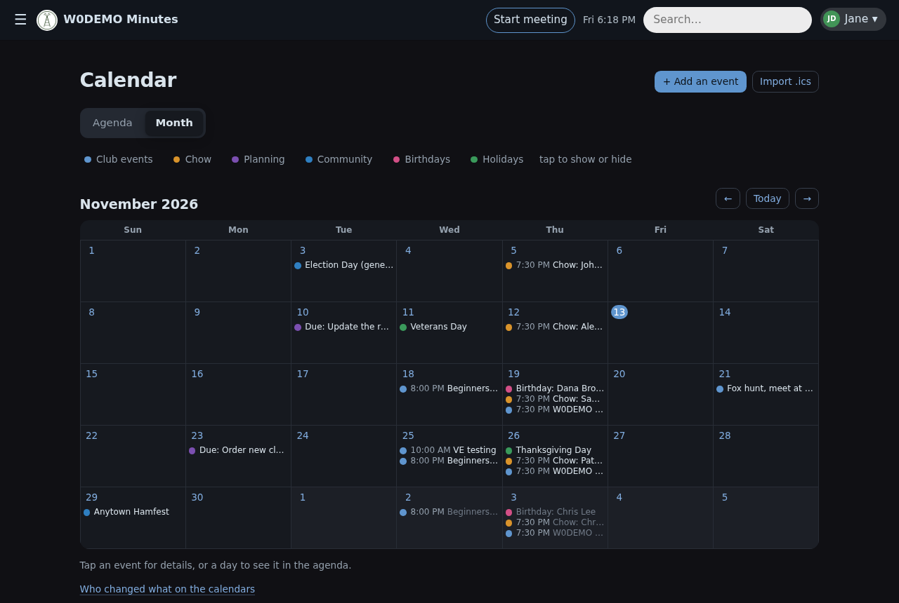
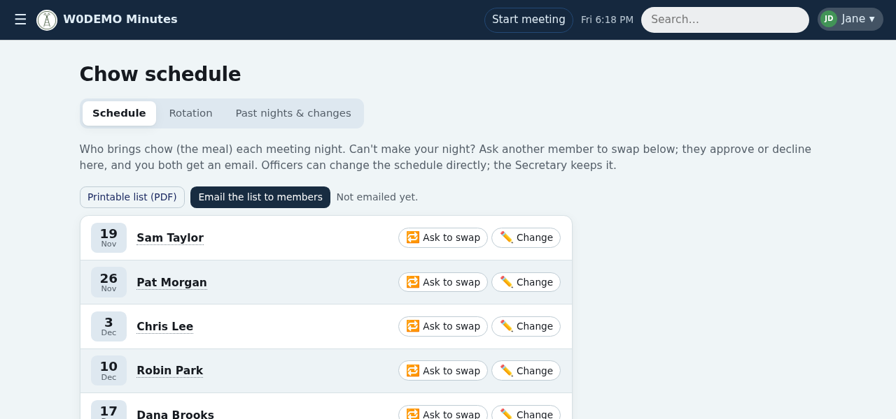
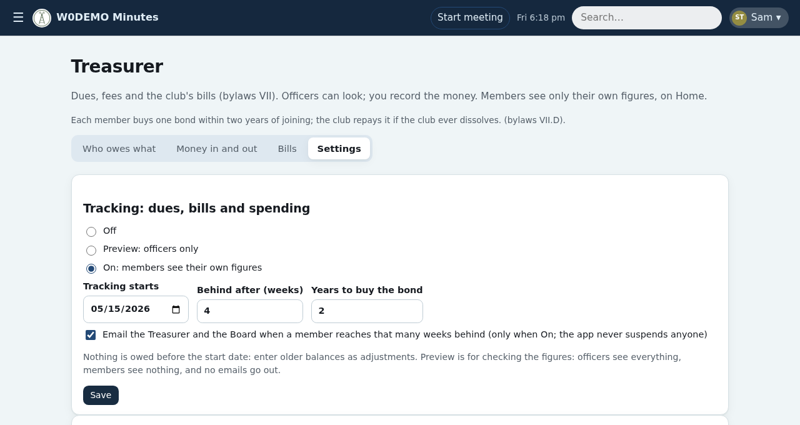
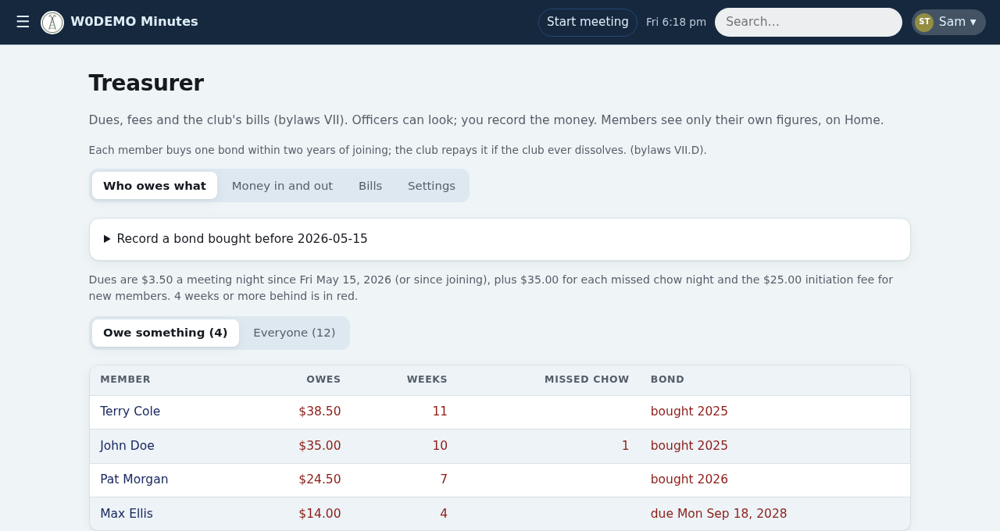
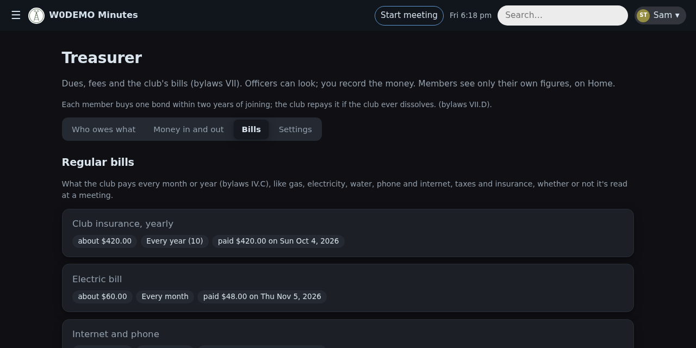
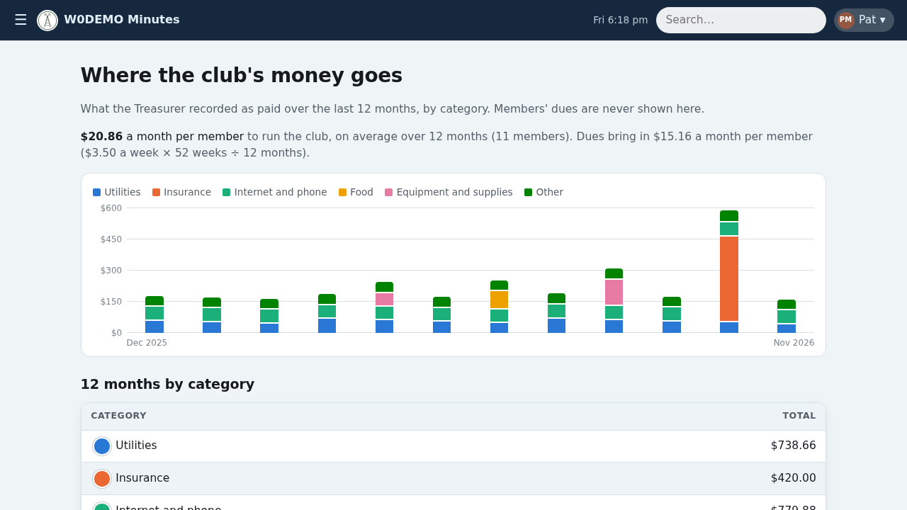

# Officers guide

For officers, minutes editors, roster keepers, calendar editors and the Treasurer: running the club from the app. What every member sees is in the [members guide](members.md).

## 🔑 Who can do what
What a member may do comes from their **roles**. Most roles follow the offices a member holds; an admin gives the other two on **Admin → Site → Roles**, which also lists what each role allows and who has it. A member's roles show on their page.

- 🏛️ **Officers** (holders of an officer's office) see every member's contact details, the change logs, and can undo profile changes; they lead meetings and edit the calendar too.
- 🎙️ **Minutes editors** (given on Site → Roles) run the meeting console and edit the minutes and the calendar.
- 📅 **Calendar editors** (given on Site → Roles, say the net manager) edit the calendar.
- 📋 **Roster keepers** (holders of the offices that add members: the Secretary and Treasurer, unless the club picks others) edit the roster.
- 💰 **The Treasurer** records money.

> [!TIP]
> Admins can do all of the above while admin mode is on.

## 👥 The roster
**Roster** in the menu. Members keep their own email, phone, address, birthday and sharing choices up to date on their profile.

- **Officers see everything**; other members see only what each member chose to share.
- **Every profile change** is emailed to the Secretary and listed under **Roster → Recent changes**, where any officer can undo it.
- **Editing a member** (roster keepers): **Edit roster details** on their page, in four tabs, each saved on its own. **Details:** name, class, status, contact details and other spellings of their name. **Titles:** their offices (shown; they change on the Offices page, which keeps their history) and other titles (ticked from those the club uses, or added). Roles aren't set here: they follow the offices, or an admin gives them on Site → Roles. **New callsign** and **Membership log** (joined, left, suspended…). Not their birthday or sharing choices: those are theirs.
- **A new callsign** (vanity call or upgrade): **New callsign** on the same page. The app takes a backup, then moves everything (minutes, chow, business, sign-ins, passkeys) to the new call. Old links keep working.
- **Birthdays and anniversaries** a member shares show at the meeting's Attendance step.
- **Offices** (Roster → Offices): who holds each office now and who held it before. An admin changes a holder in one step; the app updates both members' titles, logs it and emails the officers. **Add a past term** adds history only.

## 📅 Calendars
**Calendar** in the menu. The app keeps three calendars: **Club events** (meetings, nets, VE testing, fox hunts), **Planning** (officers' dates, like the annual meeting) and **Community** (what's on nearby). It adds chow nights, shared birthdays (never private ones), business items' due dates (on Planning), and holidays and election days if an admin turned them on.

**Adding and changing events** (leaders and calendar editors):

- Start, optional end, where, notes, an **Online link** (shown as a **Join online** button), and a time zone if it isn't the club's (Field Day in UTC, say).
- **Repeats**: daily, weekly, every 2 weeks, monthly (2nd Tuesday, last Tuesday, 1st and 3rd Tuesday, or a date), yearly.
- Change or delete a repeating event for **this date only**, **this and following dates**, or **every date**.
- Look-alike events on the same day are marked **possible duplicate**; delete one if they're the same.
- **Leave out of the leader console's Upcoming Events**: tick it for things not worth reading out (the weekly meeting is ticked already).
- **Who changed what** (officers) lists every change.

> [!TIP]
> To skip the meeting on a holiday, delete that one date.

**The weekly meeting** is on Club events. To change its day, time, place or online link, an admin uses **Admin → Site → Club** and picks the date it starts; earlier meetings stay as they were.

📥 **Import .ics** (Calendar → Import .ics): events from Google Calendar, Outlook or Apple. In Google Calendar: Settings → Import & export → Export. Importing the same file again updates rather than doubles. Anything it can't bring in is listed, to add by hand.

📲 **Subscribing:** every member gets a private link under **Subscribe in your calendar app**, for their phone or calendar app. **Make a new link** if it's been shared by mistake. An admin can also make some calendars public (Admin → Site → Features); chow, birthdays and due dates are never public.

## 🎙️ At the meeting
The leader console's **Upcoming Events** step lists what's on until the next meeting, to read out. **+ Add** puts one in the minutes. **Use the calendar's** swaps a typed entry for the calendar's own, so it shows once. Events you add in the minutes go on the calendar you pick beside them (Club events unless you change it).

## 🍲 Chow
Only if the club has the chow module (an admin turns it on under Admin → Site → Features). **Chow** in the menu.

- Members ask each other to swap; leaders change the list directly.
- On meeting night the console records who provided, missed or was covered.
- **The printable list** (PDF): officers email it to members from the Chow page, which shows whether it has changed since it was last sent.

## 💰 Treasurer
**Treasurer** in the menu: officers see it; the Treasurer (and admins in admin mode) record money and change settings.

⚙️ **Getting started (Settings tab):**

- **Tracking:** Off, **Preview** (officers see everything, members nothing, no emails: for checking the figures first) or **On** (members see their own figures on Home).
- **Start date:** nothing is owed before it. Older balances go in as adjustments on that date.
- **Amounts:** dues per meeting night, initiation fee, the bond, a missed chow night. Each change has a date it takes effect, so earlier weeks keep the old amount.
- **Arrears:** how many weeks behind counts (4 by default), and whether the Treasurer and Board get an email when someone gets there.
- **Accounts, funds** and **spending categories** (up to 8, each keeps its chart colour).

🧾 **Who owes what** is worked out, never typed: dues for every meeting night (holidays too; 52 × $3.50 is $182 a year), initiation, missed chow nights and adjustments, less payments. Members may pay weekly, monthly or yearly; paying ahead shows as "paid through" a date. Members in arrears show in red.

> [!NOTE]
> **An example:** dues are $3.50 a meeting night and tracking started 26 weeks ago, so a long-time member owes $91.00 so far. Pat has paid $66.50: Pat owes **$24.50**, 7 weeks, in red (4 weeks or more). Max joined 8 weeks ago: the $25.00 initiation fee plus 8 nights ($28.00), less what he's paid.

**The bond** (only if the club has one): who still owes it and by when. A bond bought before the app: **Record a bond bought before…** at the top of Who owes what. It's kept on file, not counted as money now.

> [!IMPORTANT]
> **Arrears and suspension:** the app never suspends anyone. When the club does, a roster keeper sets the member's status to **Suspended** and adds a Membership Log row. Dues keep counting.

**Recording money:** each expense gets a category guessed from its words ("pizza" → Food), which you can change. Payments, other income (drink sales, donations), adjustments (a charge, or a negative one as a credit) and expenses, each with a date and an account. **Delete** fixes a mistake; the log keeps it.

📄 **Bills:**

- **Regular bills** (Bills tab): what the club pays every month or year. The tab shows which haven't been paid yet.
- **Bills read at meetings:** each amount under Bills and Communications in the minutes gets its own card ("Gas Bill $81"). Mark each **Paid** (an expense), **Not a bill**, or match it to a regular bill so it isn't counted twice. Nothing counts until it's marked. **Look in older minutes** finds bills from before the start date.
- At the meeting, the console's Bills step lists what was paid since the last one; **Add to tonight's bills** puts it in the minutes.

🥤 **Funds** run by a committee (the drinks fund, say): their keepers see only their fund's account and record its money.

📊 **Spending** (in the menu): the last 12 months by category, and the cost per member each month next to what dues bring in. Every member sees it once tracking is On. It never shows anyone's dues.

> [!NOTE]
> Not a bookkeeping system: no account balances or transfers yet.
