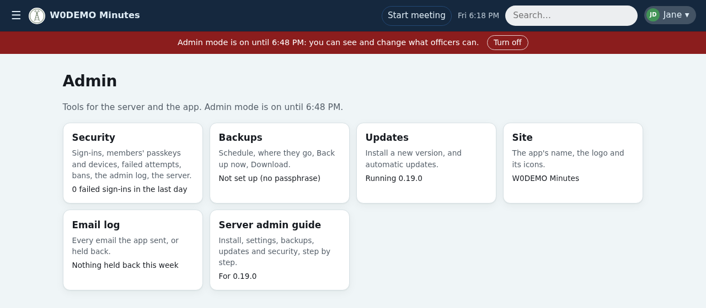
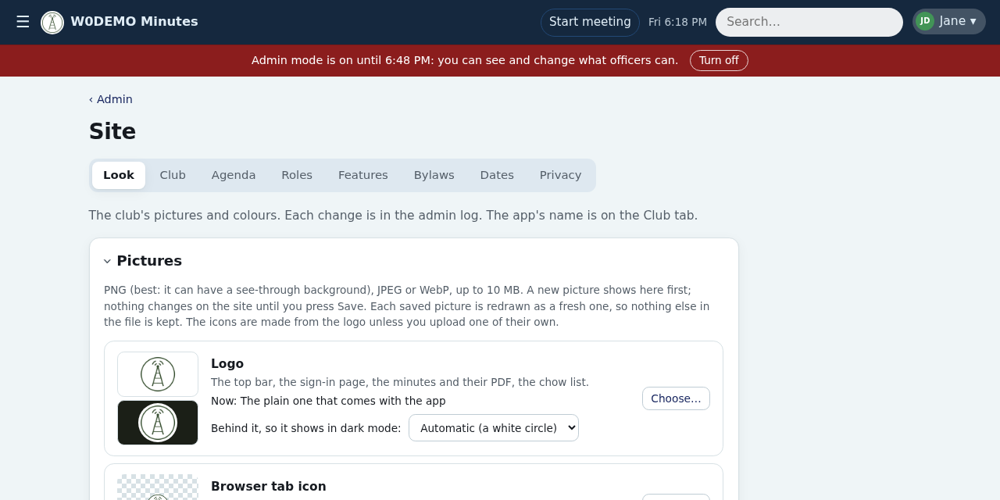
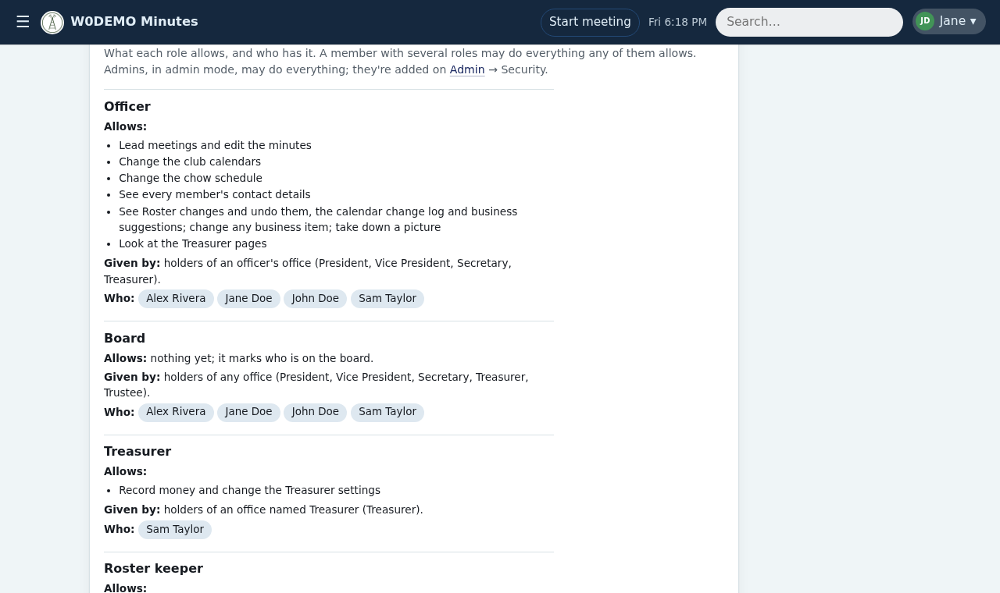
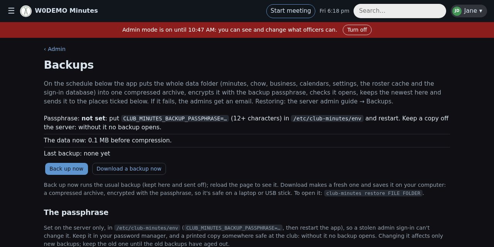

# Server admin guide

For whoever runs the server: install, configure, back up and secure the app. It's in the app too, for the version that's running: Admin → Server admin guide.

## 🚀 Getting started (a new club)
Install on a Debian container, as root:

```sh
curl -fsSL https://raw.githubusercontent.com/KO4CGQ/minutes/main/deploy/setup.sh | bash
```

To set the server's time zone too: `… | TZ_NAME=America/Chicago bash` (otherwise it keeps the server's own; the app uses that unless club.yaml names one). Then:

1. **club.yaml:** copy `club.minimal.yaml` to `/etc/club-minutes/club.yaml` and fill in its three things:
    - `meeting_day` and `meeting_time` (the app won't start without them)
    - `auth: rp_id`: the HTTPS address members will use (passkeys only work there)
    - your own callsign under `admins:`

    Everything else is set in the app (step 3) or has a default; `club.example.yaml` lists every setting, for what's only in club.yaml (sign-in, email test mode, AI).

    Then `systemctl restart club-minutes`.

2. **You, the first member:** `club-minutes first-member YOURCALL --first First --last Last --email you@example.org --class General` starts the roster with you and prints a sign-in link. It runs once: with a roster in place it refuses, so it can't overwrite one.
3. **Sign in** with that link and add a passkey when offered. Turn on admin mode (name menu → Admin), add the other members on the Roster page, put the officers in their offices on the **Offices** page (Roster → Offices; that makes them officers), and set the club's name, callsign, logo and colours on **Site**.
4. **Email** (sign-in links, the minutes): the SMTP settings in `/etc/club-minutes/env` (Sign-in and email, below). Until then, links are written to the server's log (`journalctl -u club-minutes`), and the pages say so.
5. **Backups** (Admin → Backups), before anything is entered for real.

> [!TIP]
> To update by hand: `/opt/club-minutes/deploy/update.sh` installs the latest main (`TAG=v1.0.0` before it for a release). Admin → **Updates** installs new releases from the app, or nightly.

Good to know: the app runs as the `minutes` user on port 8000, with its settings in `/etc/club-minutes/` and its data in `/var/lib/club-minutes/`. `google-service-account.json` goes in `/etc/club-minutes/` too, only for backups to Google Drive.

## 🧭 The Admin page
In admin mode, the name menu's **Admin** lists the admin tools, each with a line of how things stand.



- 🛡️ **Security:** failed sign-ins today, bans. Its **Members** tab lists every member's last sign-in, passkeys and signed-in devices, so you can see who hasn't signed in or still uses emailed links.
- 💾 **Backups:** the last one.
- ⬆️ **Updates:** what's running and what's available.
- 🎨 **Site:** the club's settings.
- ✉️ **Email log:** anything held back this week.
- 🧪 **Stage sync**, on a staging server only.

## 🎨 Site settings
Admin → **Site** changes most of the club's settings in the app, checked as you save (a wrong value is refused, saying why) and used at once, without a restart.



| Tab | What's there |
| --- | --- |
| **Look** | The logo (pages, minutes, PDFs), the browser tab icon and the phone home-screen icon, each with **Upload…** and **Reset** (the icons are made from the logo until one has its own). **Behind it**, so a dark logo on a see-through background still shows in dark mode. **Colours:** one main colour sets buttons, links, the top bar and the minutes' headings; the app makes light and dark palettes from it, checks every text colour is readable, and previews both before Save. |
| **Club** | The app's name, the club's name and callsign, meeting day and time, time zone, and the weekly meeting's place and online link. A new day, time, place or link changes the calendar's meeting from the **Starting date** you pick. |
| **Agenda** | The meeting's sections in order (built-in and the club's own), when a guest is invited to join, how many days before a reminder goes out. |
| **Roles** | The club's offices from its bylaws: each an officer's office or a board seat (like a trustee), with how many seats; and whose holders add members to the roster (usually the Secretary and the Treasurer). Who holds each office is on Roster → Offices. Then the roles: what each allows, who has it, and who is a **Minutes editor** or **Calendar editor** (the two roles given by hand, not by an office). |
| **Features** | The chow module, public calendars, holidays (any country or state, plus the club's own) and election days. |
| **Bylaws** | The bylaws sections the app cites, the arrears rule, and a certificate members buy (a bond), if the club has one. |
| **Dates** | How dates are written (US order unless changed). |
| **Privacy** | Names never recorded: a guest with one is left out of the minutes, a line with one out of imported minutes, and the AI never sees one. |



> [!NOTE]
> What's saved on Site wins over club.yaml until an admin picks **Back to club.yaml**. Sign-in (`auth:`), email test mode and AI can only be set in club.yaml; admins beyond the first are added under Security → Admins.

## 🔑 Sign-in and email
Members sign in with a passkey, or with a one-time link emailed to their roster address.

- **Passkeys** only work at the HTTPS address in club.yaml (`auth.rp_id`).
- **Email** needs `CLUB_MINUTES_SMTP_USER` and `CLUB_MINUTES_SMTP_PASSWORD` (a Gmail app password) in `/etc/club-minutes/env`. Without them, links go to the server log instead.
- **Locked out?** On the server: `club-minutes login-link N0CALL` prints a one-time link for any member.
- **AI** (optional): `CLUB_MINUTES_OPENROUTER_KEY` in the env file and `ai: {model: ...}` in club.yaml. Each call is logged (time, model, size, cost; never the text).

**Emailing the minutes:** when a leader submits them, every member with an email address (except Inactive and Silent Key) gets their own copy: the PDF, or a link, as each chose on their profile (or nothing, if they turned it off). Replies go to the meeting's leader. Each meeting is emailed once, and leaders see the outcome on the minutes page.

> [!TIP]
> **Testing email?** While club.yaml has `email.only_to`, only those callsigns or addresses get mail; everyone else's is held and logged. The submit dialog says which mode is on.

**Removing a test meeting:** `club-minutes delete-meeting 2026-12-31`, then `systemctl restart club-minutes`.

## 🛡️ Admin mode
Admins get **Turn on admin mode** in the name menu. For an hour (or until turned off) they can see and do what officers can, with a red banner showing. Each switch is logged.

- **Who's an admin:** callsigns under `admins:` in club.yaml, and members made admins in the app (Admin → Security → **Admins**). Making someone an admin asks for a passkey or emailed link unless you confirmed in the last 5 minutes; each change is emailed to the other admins, and the last admin can't be removed.
- Admins in club.yaml can only be removed there, so whoever has the server can always get back in.
- **View the app as …** (on a member's page): the app as that member sees it, read-only, until **Stop** or admin mode ends. Also logged.

## 💾 Backups
The app backs up its whole data folder into one compressed file, encrypts it with a passphrase only the admins hold, and opens it again to check it. It keeps the newest on the server and sends each to **S3-compatible storage** (Backblaze B2), a **Google Drive** folder, or both. If anything fails, the admins get an email.



Admin → **Backups** has the rest: **Back up now**, **Download a backup now**, the server's copies, the schedule (daily, weekly or by hand, at a chosen hour), how many to keep, and the S3 and Drive settings. Recommended: daily, 7 on the server, 30 on Drive, 90 days on S3.

> [!NOTE]
> Until the passphrase is set, scheduled backups don't run. With only the passphrase (no S3 or Drive), backups stay on the server: enough to undo a mistake, not to survive losing the server. The S3 secret isn't in the backups: re-enter it after a restore.

**Setup:**

1. **The passphrase:** `CLUB_MINUTES_BACKUP_PASSPHRASE=...` in `/etc/club-minutes/env`, then restart. The Backups page can **suggest** one (24 letters and digits in groups of four, easy to type from paper) and **check** yours (matches the server's, strength, and not among leaked passwords). Neither stores it.
2. **S3 / Backblaze B2:** a private bucket with a lifecycle rule (B2: Lifecycle Settings → custom rule for `minutes/`: hide files 90 days after upload, delete 1 day after hiding), and an application key limited to that bucket, read and write. Enter them on the Backups page. The app never deletes anything there.
3. **Google Drive:** a folder in a **Shared Drive** (Google Workspace); a folder in someone's My Drive fails, as service accounts have no storage of their own. Add the service account (its email is in `google-service-account.json`) as **Content manager**, and paste the folder's link on the Backups page.
4. **Back up now**, and check the page says where it went.

> [!WARNING]
> Keep a copy of the passphrase off the server: a password manager the admins share, and a printed copy somewhere safe. **Without it no backup can be opened.** It can't be set from the app on purpose: a stolen admin sign-in could otherwise set one it knows.

**Restore** (onto this server, or a fresh one set up with `setup.sh`):
```sh
sudo -u minutes /opt/club-minutes/.venv/bin/club-minutes restore BACKUP.tar.gz.enc /tmp/restored   # asks for the passphrase
systemctl stop club-minutes
rsync -a /tmp/restored/ /var/lib/club-minutes/ && chown -R minutes:minutes /var/lib/club-minutes
systemctl start club-minutes
```
`restore` only unpacks into an empty folder, never over live data. Members stay signed in, and passkeys keep working as long as the address is the same.

## 🔒 Security
The app blocks web visitors itself after repeated failed sign-ins (Admin → Security). On **Failed attempts**, **Details** shows each attempt's device and browser, and a banned address links to its ban.

**Upload limit:** Security → **Server** → **Largest upload** (1–100 MB, 10 by default), for profile pictures and calendar imports. A proxy in front of the app (Caddy, nginx, Traefik) has its own limit, which must be at least as big.

**Hardening the server** (recommended). First, fail2ban for SSH: `apt install fail2ban python3-systemd`, then create `/etc/fail2ban/jail.d/sshd.local` (list your own LAN and tailnet under `ignoreip`, so you can't lock yourself out):

```ini
[sshd]
enabled = true
backend = systemd
ignoreip = 127.0.0.1/8 ::1 192.168.1.0/24 100.64.0.0/10
```

Then `systemctl restart fail2ban` and check it with `fail2ban-client status sshd`. To lift a ban: `fail2ban-client set sshd unbanip ADDRESS`. Also:

1. SSH with keys only: `PasswordAuthentication no` in `/etc/ssh/sshd_config`.
2. Automatic security updates, with restarts: `apt install unattended-upgrades needrestart`, then `dpkg-reconfigure -plow unattended-upgrades`. In `/etc/needrestart/conf.d/50-auto.conf` put `$nrconf{restart} = 'a';` (and, in a container, `$nrconf{kernelhints} = 0;`), or needrestart only lists what needs restarting.
3. **Close the app's port to everyone but the server** (below).
4. A firewall that otherwise allows only SSH (and, without Tailscale, the proxy's 80 and 443).

**Closing the app's port.** The app listens on port 8000 on every network, in plain HTTP: anyone on your LAN could use it there, around the HTTPS proxy, and a stolen sign-in would work over it. Only the proxy on the same server (Tailscale serve, Caddy…) and the roster API's callers (a Discord bot's container) need it. With nftables (`apt install nftables`), save this as `/etc/club-minutes-firewall.nft` (one `accept` line per caller, or none):

```
table inet club_minutes
delete table inet club_minutes
table inet club_minutes {
  chain input {
    type filter hook input priority filter; policy accept;
    tcp dport 8000 iif "lo" accept
    tcp dport 8000 ip saddr 192.168.1.50 accept
    tcp dport 8000 counter drop
  }
}
```

Load it at boot with a small unit, `/etc/systemd/system/club-minutes-firewall.service`:

```ini
[Unit]
Description=Close the minutes app's port
Before=club-minutes.service

[Service]
Type=oneshot
RemainAfterExit=true
ExecStart=/usr/sbin/nft -f /etc/club-minutes-firewall.nft
ExecStop=/usr/sbin/nft delete table inet club_minutes

[Install]
WantedBy=multi-user.target
```

Then `systemctl daemon-reload && systemctl enable --now club-minutes-firewall`. Check from another machine on the LAN: `curl -m 5 http://SERVER:8000/login` should time out, while the app's https address still works. Don't use Debian's own `/etc/nftables.conf` for this: it starts with `flush ruleset`, which also removes Tailscale's rules. A Proxmox firewall rule on the container does the same job from outside.

## 🧪 Staging server (optional)
A second container that runs the app on a copy of the live data, to try a change before it's released. It pulls the live data **one way** (nightly at 03:00 server time, and **Sync now**); nothing on it can change the live server.

- Every page has a **STAGING** banner.
- Email goes only to the person whose click caused it, with "[STAGE]" in the subject; email nobody clicked for (reminders) is held. All of it is on the Email log.
- Roles are the same as live; passkeys are per address, so each person adds one on stage too (or uses emailed links).

**Setting it up:**

1. Set up the container as above (`setup.sh`; club.yaml with stage's own address under `auth:`; the SMTP settings), and `apt install rsync` on **both** servers.
2. On stage, as root: `ssh-keygen -t ed25519 -N "" -f /etc/club-minutes/stage-sync-key`.
3. On the **live** server, add its `.pub` line to `/root/.ssh/authorized_keys`, limited to reading the data folder:
    `command="rrsync -ro /var/lib/club-minutes/",restrict ssh-ed25519 AAAA... stage-sync`
4. On stage, add to `/etc/club-minutes/env`: `CLUB_MINUTES_STAGE=1` and `STAGE_SYNC_FROM=root@<live server>:./`. Leave out `CLUB_MINUTES_BACKUP_PASSPHRASE` (stage makes no backups).
5. On stage, install the sync's timer (`update.sh` doesn't, so the live server never gets it):

```sh
install -m 644 /opt/club-minutes/deploy/club-stage-sync.* /etc/systemd/system/ && systemctl daemon-reload
systemctl enable --now club-stage-sync.timer club-stage-sync.path && systemctl start club-stage-sync && systemctl restart club-minutes
```

Admin → **Stage sync** shows the last sync, **Sync now**, and **Pause nightly sync** (to keep test changes overnight). A sync replaces everything except stage's own sign-ins and passkeys, email log, backups and update settings. Stage doesn't update itself; a developer installs a branch on it (developer guide).

> [!TIP]
> **Another time for the nightly sync?** `systemctl edit club-stage-sync.timer`, and put in:
>
>     [Timer]
>     OnCalendar=
>     OnCalendar=*-*-* 05:30
>
> (the bare `OnCalendar=` clears the 03:00), then `systemctl daemon-reload && systemctl restart club-stage-sync.timer`. Updates keep it.

## 🔌 Roster API
For the club's other tools on the same server (the Discord bot): `GET /api/roster` returns active members' `callsign`, `name`, `email`, `officer` and `former` (earlier callsigns, so the bot can follow a callsign change), as JSON.

- Off until `CLUB_MINUTES_ROSTER_API_TOKEN=...` (a long random string) is in `/etc/club-minutes/env`.
- Then it answers only `Authorization: Bearer <token>` requests from the server itself or an address in `CLUB_MINUTES_ROSTER_API_ALLOW` (comma-separated; the bot's container), never through the web proxy. E.g. from the bot's container: `curl -H "Authorization: Bearer $TOKEN" http://<this server's LAN IP>:8000/api/roster`.
- Give the bot's container a fixed IP, and close port 8000 to everyone else (Security → Closing the app's port). Every call, allowed or not, is logged.

## 📜 Bylaws
The Bylaws page shows the club's constitution and bylaws from `bylaws.md` in the data folder (`/var/lib/club-minutes/bylaws.md`). It's kept out of the public repo.

## 🍲 Importing a chow spreadsheet
Once, for a club moving its chow list into the app: `club-minutes chow-import FILE.xlsx --order "Surname,Surname,..." --next Surname` prints what it found, including anything to check; add `--write` to save it (it won't overwrite an existing schedule).

## ⚙️ club.yaml
`/etc/club-minutes/club.yaml` (copied from `club.example.yaml`, which explains each setting). Most of it can be changed on Site instead; these only here:

- **Sign-in:** `auth:` (the HTTPS address passkeys use, how long a sign-in lasts).
- **Admins:** `admins:`, the callsigns who can always get in.
- **Email test mode:** `email: only_to:`.
- **AI:** `ai: {model: ...}`, and the private never-record list.
- **Offices:** `offices:`, the club's offices (a title with one seat, or `{title: Trustee, officer: false, seats: 3}` for a board seat).
- **Roster keepers:** `roster_keepers:`, the titles that may edit the roster (`[Secretary, Treasurer]` by default; admins in admin mode always can).
- **Starting links** for the Links page.

People, their titles and who may lead come from the roster the app keeps, edited on the Roster pages.

## 🗂️ Where things are kept
All in the data folder (`/var/lib/club-minutes`), and all in the backups:

- **State:** the roster (`roster-sheet.json`, rebuilt into `roster.json` daily at 04:00), `events.json` (calendars), `chow.json`, `business.json`, `treasurer.json`, `email-prefs.json`, `settings.json` (each member's display choices), `site-settings.json` (Site), `branding/` and `branding.json` (Look), `admins.json`, `limits.json`, `backup-settings.json` (not in the backups: it holds the S3 secret).
- **Logs**, each change with who made it: `profile-changes.jsonl` (roster), `calendar-log.jsonl`, `chow-log.jsonl`, `treasurer-log.jsonl`, `admin-log.jsonl`, `api-log.jsonl`, `ai-log.jsonl`, `email-log.jsonl`.
- **The minutes:** a folder per meeting, with `emailed.json` beside each saying who it was sent to.
- **`data-version`:** which shape the files are in. A new version that stores something differently reshapes the files itself at start, after copying the folder to `before-upgrade/` (not in the backups); if it then doesn't start, the update puts that copy back and returns to the version before. An older version won't start on data a newer one has reshaped: restore a backup made before the update instead.
